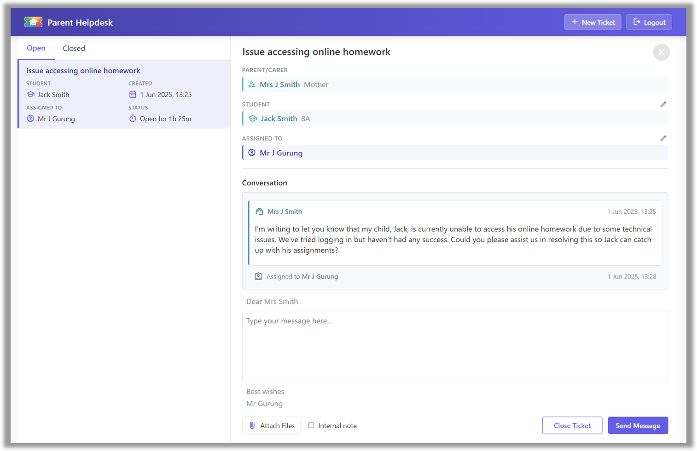

# School Helpdesk

School Helpdesk is a free, open-source web application designed to streamline communication between parents/carers and staff.

Bring your own Postmark account and deploy to Microsoft Azure.



### Features

- A clean, professional ticketing interface
- Email-based ticket submission for verified parents
- Automatic tagging of parent and student details
- Ticket assignment to specific staff
- Powerful search to quickly find previous tickets
- AI-assisted drafting to support faster, more consistent responses
- Automated notifications and follow-up reminders
- Customisable email templates
- Role-based access control for managers and staff
- Fully responsive design for desktop, tablet, and mobile use
- Microsoft 365 single sign-on for secure and convenient access

### Setup

You will need an Azure subscription, permission to manage Entra app registrations, and administrative access to your school's DNS and Microsoft 365 or Google Workspace email routing. Azure hosting, storage, AI usage, and Postmark incur charges.

1. Create a [Postmark](https://account.postmarkapp.com) Pro account.
    - Add a sender signature for your school's email domain and verify it using DNS
    - Add a server called `Helpdesk`

2. Create a general purpose v2 storage account in [Microsoft Azure](https://portal.azure.com), with account key access enabled, and within it create:
    - Blob containers: `config`, `messages`, and `attachments`
    - Queue: `emails`
    - Table: `tickets`

    Keep all blob containers private.

3. Within the `config` blob container:

    - Upload a blank file `keys.xml`. Generate a SAS URL for this file with read/write permissions and a distant expiry. This will be used to store the application's data protection keys so that auth cookies persist across app restarts.
    
    - Upload a file `holidays.csv` with the following headers and populate it with your school's holiday dates in `yyyy-MM-dd` format. The start and end dates are inclusive. Reminder emails will not be sent to staff during holidays.
        ```csv
        Start,End
        ```

    - Upload a file `students.csv` with the following headers and populate it with all students in your school. Where a student has more than one parent, repeat the student details across multiple rows. To correctly represent accented characters in student names, save the file in 'CSV UTF-8' format.

        ```csv
        FirstName,LastName,TutorGroup,Relationship,ParentTitle,ParentFirstName,ParentLastName,ParentEmailAddress,ParentPhoneNumber
        ```

    - Upload a file `staff.csv` with the following headers and populate it with all staff who should have access, including administrators. Each `Email` must be unique and match the staff member's Entra user principal name (UPN), which may differ from their email address.
    
        ```csv
        Email,Title,FirstName,LastName
        ```
    
    - Upload a file `blocklist.txt` containing one email address or domain per line that should be blocked from contacting the helpdesk. Emails from these addresses will be ignored with no bounce message sent. This is useful for blocking spam. Registered parents cannot be blocked. You can start by using a blank file.
    
    - Upload `template.html` and `template.txt` templates to use for all outgoing emails. There are sample files in the [examples](examples) folder. Replace the school details in both files. Use the token `{{BODY}}` as a placeholder for the email body.

4. Create a [Microsoft Foundry](https://ai.azure.com/) project and deploy an OpenAI reasoning model (e.g. `gpt-5.6-sol`). Record the Azure OpenAI resource's base endpoint, API key, and deployment name.

5. Create an Azure App Service web app.
    - Publish mode - Container
    - Operating system - Linux
    - Image source - Other container registries
    - Container name - `main`
    - Access type - Public
    - Registry server URL - `https://index.docker.io`
    - Image and tag - `jamesgurung/school-helpdesk:latest`
    - Port - 8080
    - Startup command: (blank)
    - Always On - enabled, using a plan that supports it
    - HTTPS Only - enabled
    - Instance count - 1; do not enable scale-out

    Ticket numbering and caches are held in application memory, so multiple instances are not supported. Reminders run at 07:30 UK time on weekdays outside the configured holidays and require the app to remain running.

6. Configure a custom domain for the web app, e.g. `helpdesk.example.sch.uk`.
    - Add the required DNS records and bind the domain to the App Service
    - Configure a TLS certificate and HTTPS binding for the domain
    - Use this hostname for `AppWebsite`, the Entra redirect URI, and the Postmark webhook

7. Create an Azure app registration.
    - Name - `School Helpdesk`
    - Platform - Web
    - Redirect URI - `https://<app-website-domain>/signin-oidc`
    - Supported account types - Accounts in this organizational directory only
    - Token configuration - add an optional claim of type ID: `upn`
    - Certificates & secrets - create a client secret and record its value, not its ID

    Record the application (client) ID and directory (tenant) ID. The app uses authorization code flow; implicit grants and Microsoft Graph permissions are not required.

8. Configure the application settings as described below. Either supply them directly as App Service environment variables or use Azure App Configuration.

    #### Bootstrap settings

    If using Azure App Configuration, create a store and supply one of the following as an App Service environment variable:

    - `AppConfigurationEndpoint` - Azure App Configuration endpoint. Enable the App Service's system-assigned managed identity and grant it the App Configuration Data Reader role.
    - `ConnectionStrings__AppConfiguration` - Azure App Configuration connection string (`ConnectionStrings:AppConfiguration` in JSON configuration).

    #### Application settings

    For direct environment variables, use the names below without a prefix, e.g. `SchoolName`. In Azure App Configuration, use `Shared:*` or `SchoolHelpdesk:*` keys with no label, e.g. `SchoolHelpdesk:SchoolName`. Restart the app after changing settings in the store.

    Include at least one administrator. All addresses in `Admins`, `Managers`, and `Dispatchers` must also appear in `staff.csv`. Administrators inherit manager permissions; managers inherit dispatcher permissions. Other staff can access their assigned tickets.

    - `Admins` - a comma-separated list of admin email addresses; admins have full administrative access
    - `AIFoundryApiKey` - the API key for the Azure OpenAI resource hosting your deployment
    - `AIFoundryDeployment` - the name of the deployed OpenAI model that you would like to use
    - `AIFoundryEndpoint` - the resource's base endpoint, e.g. `https://<resource>.cognitiveservices.azure.com/`; the app appends `/openai/v1/`
    - `AppWebsite` - the host name where this app will be hosted, e.g. `example.com`, without a scheme or path
    - `DataProtectionBlobUri` - the SAS URL for the keys file you created earlier
    - `DebugEmail` - redirects outgoing emails to this address whenever set, including in production; omit for normal operation (required for Debug builds)
    - `Dispatchers` - a comma-separated list of dispatcher email addresses; dispatchers can create tickets assigned to staff, but reassigning existing tickets requires manager permissions
    - `ForwardingProvider` - the provider that forwards inbound helpdesk email; must be `Microsoft` or `Google`
    - `HelpdeskEmail` - the email address that will be used to send and receive helpdesk tickets
    - `Managers` - a comma-separated list of manager email addresses; managers can create, view, and edit all tickets
    - `MicrosoftClientId` - the client ID of your Microsoft Entra app registration
    - `MicrosoftClientSecret` - the client secret of your Microsoft Entra app registration
    - `MicrosoftTenantId` - your Microsoft Entra tenant ID
    - `NotifyFirstManager` - set to `true` to notify the first email address in `Managers` of new tickets submitted by email; requires a nonempty manager list with its first entry in `staff.csv` (defaults to `false`)
    - `PostmarkInboundAuthKey` - a secret UUID of your choice, used to verify that incoming emails are from Postmark
    - `PostmarkServerToken` - the token for your Postmark server
    - `SchoolName` - the name of your school
    - `StorageAccountKey` - the key for your Azure Storage account
    - `StorageAccountName` - the name of your Azure Storage account
    - `SyncApiKey` - the secret key to use if you update the `students.csv` and `staff.csv` files with an automated script (optional)

9. Configure your Postmark server's Default Inbound Stream settings:
    - Set the webhook to `https://<app-website-domain>/inbound?auth=<authkey>`, using the same secret as `PostmarkInboundAuthKey`
    - In Exchange or Google Workspace, route mail for `HelpdeskEmail` to the Postmark inbound address, preserving the original sender and authentication headers; allow external forwarding for this address where required
    - Set `ForwardingProvider` to match your email provider and ensure Postmark can send as `HelpdeskEmail` using the server's `outbound` message stream

10. Verify setup before going live:
    - Sign in as an administrator and check a regular staff account's access
    - Send from an address in `students.csv`, assign the resulting ticket, and send a staff response
    - Reply as the parent and confirm it updates the same ticket; test attachments and an AI suggestion
    - Check an unregistered sender receives a rejection and confirm scheduled reminders are delivered

    For startup failures, inspect App Service container logs and check required settings, storage access, and CSV formatting. For login failures, check the redirect URI, `upn` claim, and `staff.csv`. For missing email, check routing, Postmark delivery/webhook records, and the sender verification rules below; a successful webhook response alone does not confirm ticket creation.

### Maintenance

- After replacing CSVs, templates, or the blocklist in `config`, restart the app or visit `/api/refresh` while signed in as an administrator. This reloads blob configuration, not application settings.
- To automate staff/student updates, send `PUT /api/users` with an `X-Api-Key` header matching `SyncApiKey` and a multipart form containing both files, named `staff` and `students`. A successful upload reloads the data and returns HTTP 204.
- Administrators can download a ZIP export from `/backup`. It excludes `keys.xml`, queues, and application settings; maintain separate backups of these as needed and a tested restoration procedure. There is no built-in restore endpoint.
- Renew the Entra client secret and data-protection SAS before expiry, updating the corresponding settings. Preserve `keys.xml` when updating the application.
- For upgrades, record the current container image digest, deploy the new image, and repeat the setup checks. The `latest` tag can change; retain the previous digest for rollback.

### Sender verification

The inbound relay chain is trusted as follows:

- **School email server → Postmark:** the Postmark inbound address is secret.
- **Postmark → helpdesk app:** the webhook `auth` value is secret.

When an email is received, the helpdesk app verifies the sender in the following order:

1. **Verify the webhook.** Require the webhook `auth` value to match `PostmarkInboundAuthKey`.
2. **Verify the forwarding relay.** Require the relay to pass SPF.
3. **Reject spam.** Check Postmark's `X-Spam-Status` header, if present, and reject messages marked as spam.
4. **Verify the original sender.** Require at least one of the following checks to pass:
   - Postmark's `X-Spam-Tests` header contains `DKIM_VALID_AU`.
   - For schools using Microsoft email servers, the first `Authentication-Results` header contains either `compauth=pass` or `dmarc=pass`.
   - For schools using Google email servers, the first `Authentication-Results` header contains `dmarc=pass`, or contains `dkim=pass` or `spf=pass` with the authenticated `header.d`/`header.i` or `smtp.mailfrom` domain exactly matching the domain in the `From` address.
5. **Reject automated replies.** Reject messages whose `Auto-Submitted` header is present and has any value other than `no`. Also reject messages with a subject beginning `Automatic reply: `.
6. **Require a registered parent address.** Create tickets only when the sender address belongs to a registered parent. At this stage only, unknown addresses receive an automated rejection reply.

### Contributing

If you have a question or feature request, please open an issue.

To contribute improvements to this project, or to adapt the code for the specific needs of your school, you are welcome to fork the repository.

Pull requests are welcome; please open an issue first to discuss.
